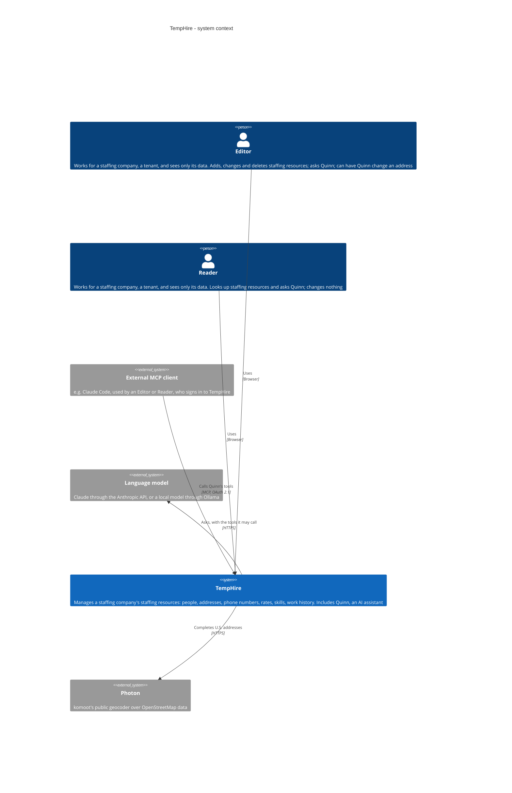
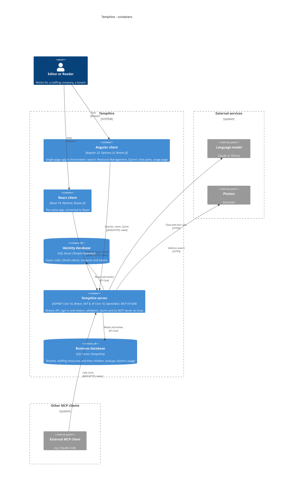
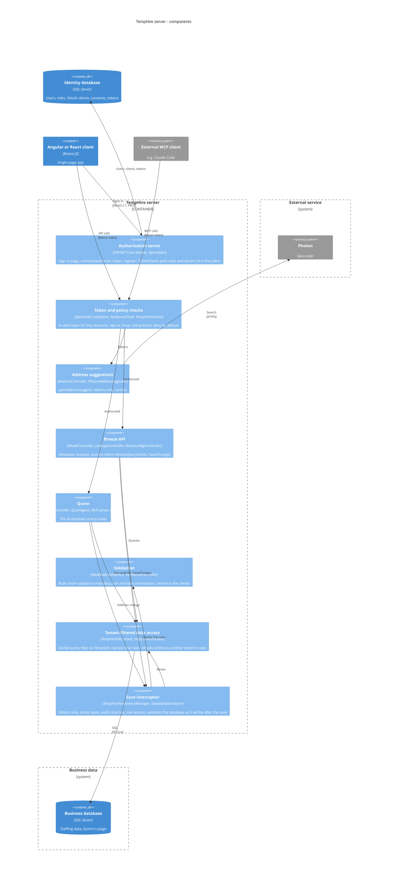

# TempHire's architecture (C4 model)

TempHire's architecture as a [C4 model](https://c4model.com): the system in its surroundings
(level 1), the deployable parts it is made of (level 2), and the components inside the server
(level 3).  Quinn, the AI assistant, has a page of its own, with its components and the flow of a
question and of a change: [Quinn's architecture](QUINN-ARCHITECTURE.md).

Every element below exists in the code of this repository or of the two clients; the names in the
descriptions are the classes and endpoints that implement it.  The [README](../README.md)
describes each part in detail, and the diagrams link to its sections in the text.

**Contents**

- [Level 1: System context](#level-1-system-context)
- [Level 2: Containers](#level-2-containers)
- [Level 3: Components of the server](#level-3-components-of-the-server)
  - [Who may call what](#who-may-call-what)
- [Keeping the diagrams true](#keeping-the-diagrams-true)

---

## Level 1: System context

**For anyone new to TempHire** - a product owner, a new developer, a security reviewer starting
out: who uses it, and what it depends on outside itself.

- **Users belong to a company, a tenant**, taken from their email domain (`harbor.test` is Harbor
  Staffing), and see only that company's data.  Their role decides what they may do: an
  **Editor** may change data, a **Reader** may only look.  A user with neither role can sign in,
  but sees no data.  See [Multi-tenancy](../README.md#multi-tenancy) and [Roles](../README.md#roles).
- **The language model** answers Quinn's questions: Claude, or a model running locally in Ollama,
  which keeps everything on the machine.  The model sees the questions and the tool results, never
  a token or a tenant id.  See [Ollama or Claude](../README.md#ollama-or-claude).
- **Photon** suggests U.S. addresses as an editor types, and completes the address Quinn is asked
  to change.  No API key.  See [Address completion](../README.md#address-completion).
- **External MCP clients**, such as Claude Code, can use Quinn's tools directly: they register,
  the user signs in and consents, and the tools run with that user's company and role.  See
  [Using TempHire's MCP server from Claude Code](../README.md#using-temphires-mcp-server-from-claude-code).

There are no other systems: TempHire signs users in itself, as its own OAuth 2.1 authorization
server, rather than through an outside identity provider (one can be added; see
[Adding an external provider](../README.md#adding-an-external-provider-such-as-microsoft-entra-id)).

## Level 2: Containers

**For developers and operators**: what runs where, what talks to what, and over which protocol.

- **Two clients, one server.**  The Angular and React clients are the same application, built
  twice; each repository has this server as a git submodule in `server/`.  Each runs its own copy
  of the server with its own pair of databases (port 5000 and `TempHire` for Angular, 5100 and
  `TempHireReact` for React; see [In a client repository](../README.md#in-a-client-repository)), so
  the diagram shows one server container used by either client.
- **Where the clients come from.**  In development each client runs on its own dev server (4200,
  5173) and calls the server across origins (CORS, `AllowedClientOrigins`).  In production its
  build is copied into the server's `wwwroot`, and the server serves it from its own origin.
- **Every request carries an access token.**  The clients sign the user in with the Authorization
  Code flow and PKCE, against the server itself, and send the token with every call.  The
  sign-in page is the server's: no client ever sees a password.
- **Two databases**, as the original desktop application had: the business data, and the users.
  OpenIddict keeps its clients, consents and tokens in the identity database; Quinn's usage table
  lives in the business database, with a context of its own (`QuinnUsageDbContext`).  The server
  migrates and seeds both on startup, a convenience for a sample (see
  [The database schema](../README.md#the-database-schema)).
- **The agent runs in the server, not in the browser**: the model, its API key and the tools stay
  out of the client's reach.  The client sends the conversation and shows the streamed answer.

## Level 3: Components of the server

**For developers working on the server, and for security review**: how a request is
authenticated, authorized, confined to its tenant and validated.  Quinn appears here as one
component; [Quinn's architecture](QUINN-ARCHITECTURE.md) opens it up.

Following one request through it:

1. **Sign-in** (`SignInController`, `AuthorizationController`, OpenIddict over ASP.NET Core
   Identity).  `TokenClaims` writes the user's roles and company (`tenant_id`, a GUID found by
   `TenantResolver` from the email domain) into every access token it issues or refreshes, so a
   role change takes effect at the next refresh.  Tokens last 30 minutes and name the resources
   they are for (RFC 8707): the app's tokens name `/api` and `/mcp`, an MCP client's only `/mcp`.
   See [Users and sign-in](../README.md#users-and-sign-in).
2. **Token and policy checks.**  OpenIddict's validation checks the token's signature,
   `AudienceCheck` that it was issued for the resource being called, and the policies in
   `TempHirePolicies` the user's role, endpoint by endpoint.  A fallback policy closes any
   endpoint that doesn't say who may call it.
3. **Breeze queries** run through `TempHireDbContext`, whose **global query filter** adds
   `TenantId = <the token's tenant>` to every query of a tenant-owned entity.  No query names the
   tenant, and the client never sees the column.  `BreezeQueryLimits` caps what a client-composed
   query may ask for (1000 rows, `expand` depth per endpoint).  See
   [Query limits](../README.md#query-limits).
4. **Breeze saves** go through the save interceptor, `TempHirePersistenceManager`: editors only,
   only the staffing entities (lookups are read-only), audit columns, an optimistic concurrency
   check on `RowVersion`, and the validation rules, checked by IdeaBlade Validation against the
   database as it will be after the save (`SaveValidationStore`).  `TempHireDbContext` then stamps
   new rows with the tenant and refuses changes to another tenant's rows (403).  See
   [Validation](../README.md#validation).
5. **Validation rules are written once**, in `validation.metadata.json` and the entities' data
   annotations.  `ValidationController` serves them to the clients, which check them as the user
   edits; the server checks them again on every save.
6. **Quinn** uses the same data access and the same save interceptor: its tools see only the
   user's tenant, and its one change, an address, is saved as a Breeze save bundle through the
   interceptor.

### Who may call what

The policies in `TempHirePolicies`, enforced by the server for every endpoint
(`AuthorizationRulesTests` fails for an endpoint that doesn't declare one):

| Who | Endpoints |
|---|---|
| Anyone | Sign-in page, `connect/authorize`, `connect/token`, `connect/logout`, `connect/register` (rate-limited), `.well-known` metadata, the client app's files |
| Any signed-in user | `api/account/me`, `api/model`, `api/lookups`, `api/validation`, Quinn's `api/agent/*` and `api/usage`, connecting to `/mcp` |
| Editor or Reader (`ReadStaffingData`) | `api/resourcemgt` queries; Quinn's read tools |
| Editor (`EditStaffingData`) | `api/resourcemgt/SaveChanges`, `api/address/suggest`, Quinn's address update tools |

The save interceptor and the MCP server's filters (`McpAccessRules`) check the same
`TempHirePolicies.CanEdit` and `CanRead` again where the work happens.  The clients hide what a
user's role doesn't allow, but that is convenience, not security.

## Keeping the diagrams true

The diagrams are Mermaid, in this file, so they change in the same pull request as the code.
When a part is added or renamed - a controller, a database, an outside service, a tool - update
the diagram it belongs to and the class names in its description.
