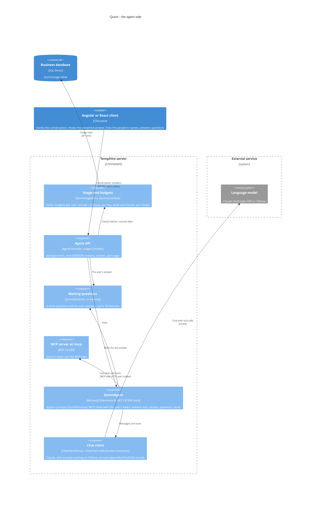
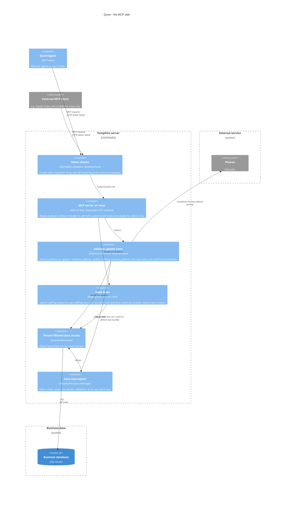
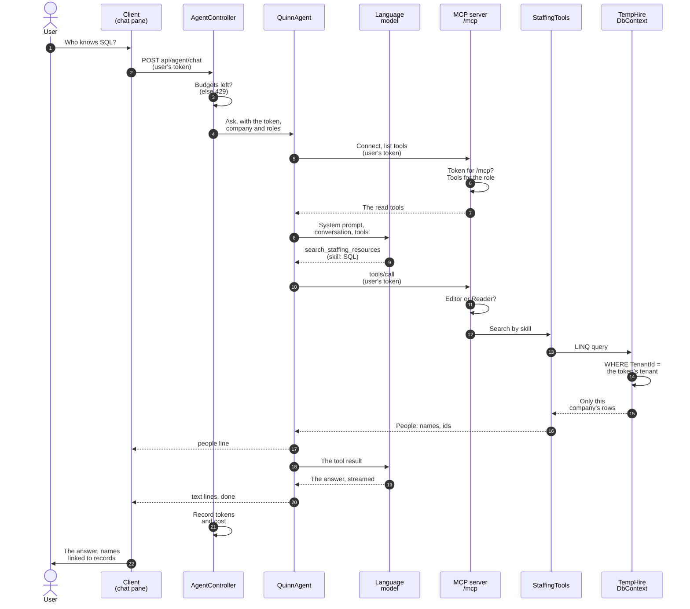
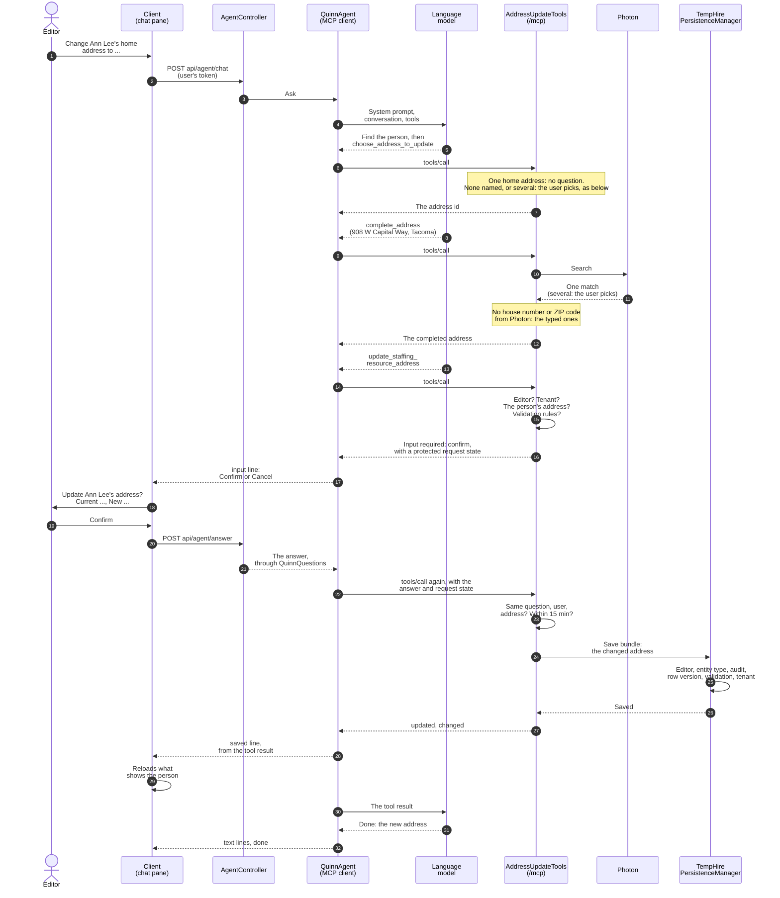

# Quinn's architecture

Quinn is TempHire's AI assistant: it answers questions about the signed-in user's company's
staffing data, and lets an editor change an existing address.  This page opens up the *Quinn*
component of [TempHire's C4 model](ARCHITECTURE.md): Quinn's components (C4 level 3), the flow of
a question and of a change (dynamic views, drawn as sequence diagrams), and why it is built this
way.  The README's [Quinn, the assistant](../README.md#quinn-the-assistant) describes each part in
more detail.

**For developers working on Quinn, and for anyone reviewing how an AI agent is given access to
business data**: where the model sits, what it can reach, and what holds whatever the model asks
for.

**Contents**

- [Components](#components)
  - [The agent side](#the-agent-side)
  - [The MCP side](#the-mcp-side)
- [A question](#a-question)
- [A change](#a-change)
- [Why it's built this way](#why-its-built-this-way)

---

## Components

Quinn has two halves, joined by MCP over HTTP: an **agent**, which talks to the client and the
model, and an **MCP server** at `/mcp`, which holds the tools.  Both run in the TempHire server.
The agent calls the MCP server like any other MCP client would, with the signed-in user's own
access token, so the MCP endpoint is the one security boundary between the model and the data.

### The agent side

- **The client keeps the conversation**, sends it whole with each question to
  `POST api/agent/chat`, and gets the answer as newline-delimited JSON: `text` pieces, the
  `people` the tools returned, `input` (a question for the user), `saved` (what a tool saved) and
  `done`.  The server keeps no chat state, and the system prompt is the server's alone.
- **`AgentController`** checks the budgets before a question (a used-up budget answers 429 with
  `Retry-After`) and records the question's tokens and cost when the answer ends, however it ends.
- **`QuinnAgent`** builds the system prompt from `QuinnPersona` (company, user, what their role
  allows), connects to `/mcp` with the user's token, lists the tools the user may use, and runs
  the model through Microsoft.Extensions.AI.  `ChatClientFactory` builds the `IChatClient` for the
  configured provider with automatic function invocation, so the tool loop runs in the server.
  The rest of the agent doesn't know which model it has.
- **Links to people** come from the tool results, not the model: `ToolResultPeople` picks the
  people (name and id) out of the tool results, and the client turns those names in the answer
  into links.  A name the model gets wrong, or invents, stays plain text.
- **Budgets** are in US dollars, from the token counts the model reports (cache reads and writes
  priced separately), in a `QuinnUsage` row per company, user, model and UTC day.  See
  [Budgets: usage and quotas](../README.md#budgets-usage-and-quotas).

### The MCP side

- **One endpoint for every MCP client.**  `/mcp` is mapped with `RequireAuthorization()` and
  accepts only tokens issued for it.  Quinn's agent and an outside client such as Claude Code go
  through the same checks and the same filters; the outside client signs the user in itself
  (dynamic client registration, sign-in, consent).  See
  [Using TempHire's MCP server from Claude Code](../README.md#using-temphires-mcp-server-from-claude-code).
- **The read tools query with EF Core LINQ, not SQL**, through the same `TempHireDbContext` as
  Breeze, so the tenant filter applies to them as to everything else.  The model fills in a tool's
  parameters (a name, a skill, a state); it never writes a query.
- **The address update tools** are the only ones that change data, and only an existing
  address's street, city, state and ZIP code.  They check the user's role, the rows' tenant, that
  the address belongs to the person, and the validation rules, and they save through the same
  save interceptor as a client's save.  See
  [Changing an address through Quinn](../README.md#changing-an-address-through-quinn).
- **Stateless.**  Each MCP request carries the user's token and gets fresh tool instances with
  that request's tenant-filtered context.  A tool that needs the user's answer answers its call
  with the question; the client calls again with the answer (multi round-trip requests, MCP's
  `2026-07-28` revision).

## A question

*"Who knows SQL?"*, asked by a reader or an editor.  The dynamic view as a sequence diagram:

- **Steps 5-6 and 10-11**: the agent has no access of its own.  It calls `/mcp` with the user's
  token, so the tools run with that user's identity, company and role; the model never sees the
  token or the tenant.
- **Steps 14-15**: the tenant is added by the data access layer, not by the tool and not by the
  model.  Nothing the model passes can reach another company's rows.
- **Step 17**: the people the answer may link to come from the tool result, so a link always leads
  to a record the user may see.
- **Several tool calls**: the model may call more tools before it answers (steps 9-18 again), up
  to `Agent:MaxToolCalls` rounds.

## A change

*"Change Ann Lee's home address to 908 W Capital Way, Tacoma"*, asked by an editor.  The budget
check, the connection and the token checks are as in the question above (steps 3 and 5-7) and
left out here, and so is each tool result going back to the model; for an editor the tool list
includes the three address update tools.

- **Steps 11-12: Photon's gaps are filled from what the user typed.**  OpenStreetMap's U.S. house
  numbers have gaps, so a match may be only the street, or have no ZIP code.  It then gets the
  house number the user gave first, and a ZIP code they gave after it, so "908 W Capital Way,
  Tacoma" completes to that house, not to the street.  The address service does this
  (`PhotonAddressSuggester`), not the tool, so the address form's completion fills the same gaps
  from what the editor types into Address 1.  See
  [Address completion](../README.md#address-completion).
- **Steps 16-22: the user answers, not the model.**  The confirmation is an
  [MCP elicitation](https://modelcontextprotocol.io/specification/2025-11-25/client/elicitation):
  the tool asks the user through the MCP client in the middle of its call.  `QuinnAgent`'s
  elicitation handler puts the question in the answer stream and waits in `QuinnQuestions` for the
  user's click, which only that user can give, once, within 10 minutes.  The model sees only the
  tool's result, so it can't confirm for the user, and neither can text in the data it reads.
  The choices (which address, which of several Photon matches) go the same way.
- **Step 23: an answer counts only for its question.**  The request state is the question's
  fingerprint (the person, the address, its row version and the new values), protected with
  ASP.NET Core Data Protection for that user for 15 minutes (`McpUserInput`).  A client can't
  answer a question it was never asked, and an address changed in the meantime is asked about
  again.
- **Steps 15 and 25: checked twice.**  The tool checks the role, the tenant, the person and the
  validation rules before it asks, so the user is never asked to confirm a change that can't be
  saved; the save interceptor checks them again on the write, and the row version turns a change
  someone else made meanwhile into a conflict that saves nothing.
- **Step 28: what was saved comes from the tool, not the model.**  `ToolResultChanges` reads it
  from the tool result's `changed` list.  The client refreshes what it shows, and keeps each
  change's summary with the answer, so the next question's conversation says what was saved.
- **Cancel** at any question ends the tool call with "Nothing was changed", and the model says so.

## Why it's built this way

- **The server enforces tenant isolation and roles, not the model.**  The agent calls the MCP
  server with the user's own token, which names their company and roles; the tenant filter in
  `TempHireDbContext` confines every query and write, and the roles are checked by the MCP
  server's filters and again in the tools and the save interceptor.  The system prompt tells the
  model what the user may do, so it answers helpfully, but nothing depends on the model obeying
  it: a prompt injection in the data, or a wrong tool argument, still meets the same checks.
- **One security boundary, the MCP endpoint.**  Calling its own server over HTTP costs a little,
  but the agent then has no access path the MCP endpoint doesn't check, and outside MCP clients
  get exactly the same rules.  Their tokens are for `/mcp` only, so they can't call the Breeze API.
- **The user confirms every change.**  Changing data is limited to one narrow operation, and the
  confirmation is an elicitation answered by the user in the client, tied to the exact change by a
  protected request state.  A client that can't ask the user gets a refusal, not a change.
- **Costs are budgeted per user and per company.**  Every question is checked against daily,
  weekly and monthly dollar budgets, for the user and for the company, before it starts; the
  company's monthly limit is the budget, the others keep one day or one user from using it up.
  Prompt caching (Claude) cuts the cost of the repeated system prompt and tools.  A local model
  through Ollama costs nothing, and its usage is still counted.
- **The model is replaceable.**  Microsoft.Extensions.AI's `IChatClient` hides the provider, so
  Claude and a local Ollama model get the same system prompt, the same tools and the same data;
  switching is a setting (`Agent:Provider`).  See [Ollama or Claude](../README.md#ollama-or-claude).
- **Facts the client shows come from tool results, not from the model's text**: the people it
  links to and the changes it refreshes.  The model's text is shown as its answer, with the note
  that Quinn can make mistakes.

What this design leaves open is listed in the README's [Known gaps](../README.md#known-gaps): a
question waiting for the user is held in one server's memory, and budgets start over at midnight
UTC.
